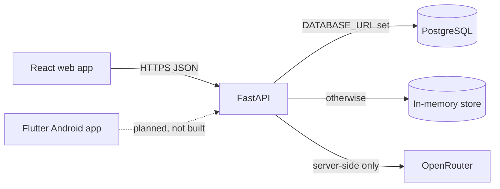

# Architecture

## Components

| Component | Location | Status |
|---|---|---|
| Web client (React) | `apps/frontend` | Implemented; talks to the API |
| Android client (Flutter) | `apps/mobile` | Welcome screen only; no API calls |
| API (FastAPI) | `apps/backend` | Implemented |
| Storage | in-memory or PostgreSQL | Both implemented |
| Assistant | backend proxy to OpenRouter | Implemented; model id unverified |

The dashed line is planned work. The Flutter app currently makes no network requests. Its main manifest declares no permissions; debug and profile builds add `INTERNET` by Flutter default.

## Web client

Single-page React app with in-memory screen state (no router, nothing persisted in the browser): Landing, Incident type, Details, Next step (submit), Confirmation. The admin screen is reachable only at `/#admin`, shows mock data, and renders only when `VITE_PROTOTYPE` is not `false`; it is not an authorisation mechanism. Quick Exit is bound to Escape on `window` and to a header button, and replaces the page with a neutral URL. The assistant modal sits beside, not inside, the page content so the page can be made `inert` while it is open.

## Backend

`main.py` mounts the report router, the assistant router, CORS (origin `http://localhost:5173` only), a readiness route and a generic 503 handler for database failures. Modules: `reports.py` (routes and admin check), `store.py` (selects the store), `store_pg.py` (PostgreSQL), `db.py` (pool), `ratelimit.py`, `assistant.py`, `schemas.py`, `migrate.py`. Routes are synchronous and run in the framework thread pool. See [API.md](API.md).

## Storage modes

| | Development | Production |
|---|---|---|
| Selection | `DATABASE_URL` unset | `DATABASE_URL` set; `SAFESIGNAL_ENV=production` makes it mandatory |
| Persistence | None; cleared on restart | PostgreSQL |
| Fallback | n/a | None: a database failure returns 503, never memory |
| Schema | n/a | Versioned SQL in `apps/backend/migrations`, applied explicitly with `python migrate.py` |

Details and operations: [apps/backend/DATABASE.md](../apps/backend/DATABASE.md).

## Incident submission flow

1. The client builds the payload (trimmed fields; no phone number or GPS) and a random idempotency key.
2. `POST /api/reports` with header `Idempotency-Key`.
3. The server validates, hashes the payload, and in one transaction (database) or one lock (memory) either returns the stored result for a matching key, returns 409 for a key reused with a different payload, or creates the report. The report-rate limit is charged only when a new report is created, inside that same critical section.
4. The client shows the returned reference code.

## Idempotency

The key is generated per logical submission and kept only in memory: reused across retries and Back/Forward when the final payload is identical, replaced when it changes, and cleared after success. A replay returns the original report with status 201 and costs no rate-limit allowance. In PostgreSQL mode keys are stored in `idempotency_keys` with a foreign key to the report, so they survive restarts; in memory mode they do not. Requests without a key are not idempotent. There is no expiry of keys yet.

## Assistant

The client sends a question and up to 6 prior turns to `POST /api/assistant/chat`. The server redacts obvious identifiers, answers fixed emergency wording for danger phrases without calling the provider, and otherwise calls OpenRouter with a concise system prompt and bounded tokens and timeout. The API key and model are backend environment variables and never reach a client. If the provider fails, the web client falls back to built-in guidance. Incident reports are never sent to the assistant.

## Configuration boundaries

- Browser bundle (public): `VITE_API_URL`, `VITE_PROTOTYPE`.
- Backend secrets: `SAFESIGNAL_ADMIN_KEY`, `OPENROUTER_API_KEY`, `DATABASE_URL`, `DATABASE_MIGRATE_URL`.
- Templates: `apps/*/.env.example`. Real `.env` files are git-ignored.
- Mobile: no secrets may be embedded in the app.
